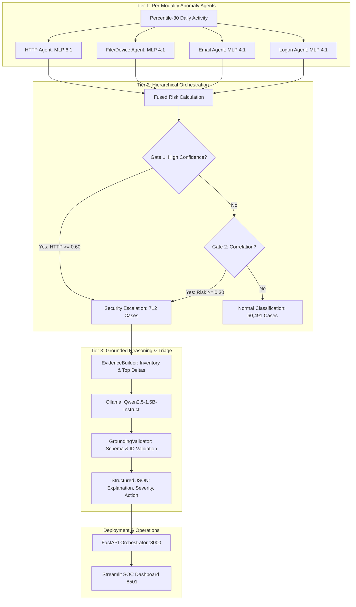

# Hierarchical Multi-Agent System for Insider Threat Detection

A hierarchical deep-learning and multi-agent system for insider threat detection evaluated on the Carnegie Mellon SEI CERT Insider Threat Dataset v4.2.The raw CERT v4.2 modality logs were processed using the MIT-provided feature_extraction.py script to generate the pre-aggregated dayr4.2.csv containing daily behavioral features. This file was then processed using the MIT-provided temporal representation script, producing dayr4.2-percentile30.csv, the temporal and percentile-based representation used by the downstream detection pipeline.

Raw CERT v4.2 Logs
        ↓
MIT feature_extraction.py
        ↓
dayr4.2.csv
        ↓
MIT Temporal Representation Script
        ↓
dayr4.2-percentile30.csv

The system structures anomaly detection into three distinct tiers:
1. **Tier 1 (Per-Modality Deep Learning Agents):** Independent PyTorch neural network agents dedicated to four distinct behavioral modalities (**Logon**, **Email**, **File/Device**, and **HTTP**).
2. **Tier 2 (Hierarchical Orchestrator & Sequential Gating):** A LangGraph multi-agent orchestrator implementing two-stage sequential gating (High-Confidence Gate + Correlation Gate) to escalate suspicious user-days while filtering 98.8% of normal activity.
3. **Tier 3 (Grounded LLM Reasoning & Triage):** A local LLM module (`Qwen2.5-1.5B-Instruct` via Ollama) generating structured, analyst-ready incident explanations, severity ratings, and recommended actions without ground-truth leakage.
4. **Deployment (Microservices & Dashboard):** A multi-container Docker Compose architecture with live FastAPI endpoints, cryptographic SHA-256 artifact verification, and an interactive Streamlit analyst dashboard.

---

## Architecture Overview



---

## Dataset & Canonical 60/20/20 User-Level Split

To eliminate data leakage, the 1,000 corporate users in CERT r4.2 are partitioned strictly at the **user level**, stratifying on malicious user status:

| Partition | Unique Users | Malicious Users | Total User-Days | Malicious User-Days |
|---|:---:|:---:|:---:|:---:|
| **Train (60%)** | 600 | 42 (70.0%) | 185,744 | 564 |
| **Validation (20%)** | 200 | 14 (70.0%) | 61,076 | 201 |
| **Held-Out Test (20%)** | 200 | 14 (70.0%) | 61,203 | 201 |
| **Total (100%)** | **1,000** | **70 (7.0%)** | **308,023** | **966** |

- **User Splits:** `data/user_splits/{train,val,test}_users.npy`
- **Percentile Pre-Split:** `data/user_split_formlp/dayr4.2-percentile30-{train,validation,test}.pkl`

---

## Final System Configuration & Held-Out Test Results

### 1. Final Model Configurations
- **Tier-1 Agents:** 3-layer `ModalityFFNN` MLPs ($64 \rightarrow 32 \rightarrow 1$) with dropout ($0.2$) trained on 30-day temporal percentile representations using `BCEWithLogitsLoss`:
  - **HTTP:** 6:1 Random Under-Sampling (204 features)
  - **File/Device:** 4:1 Random Under-Sampling (215 features)
  - **Email:** 4:1 Random Under-Sampling (47 features)
  - **Logon:** 4:1 Random Under-Sampling (20 features)
- **Tier-2 Gating Configuration:**
  - **High-Confidence Gate Threshold:** $0.60$ (HTTP channel)
  - **Correlation Gate Threshold:** $0.30$ (Fused Risk)
  - **Fusion Weights:** HTTP $0.50$, File/Device $0.20$, Logon $0.15$, Email $0.15$

### 2. Held-Out Test Performance (200 Test Users, 61,203 User-Days)

| Evaluation Metric | Week 1 Flat RF Baseline | Tier-2 Weighted Fusion | Final Hierarchical Multi-Agent System |
|---|:---:|:---:|:---:|
| **Recall (TPR)** | 0.6418 (129 / 201) | 0.8657 (174 / 201) | **0.8856 (178 / 201)** |
| **Precision** | 0.2074 | 0.2311 | **0.2500 (178 / 712)** |
| **F1 Score** | 0.3135 | 0.3648 | **0.3899** |
| **False Positive Rate (FPR)** | 0.0081 (493 / 61,002) | 0.0095 (579 / 61,002) | **0.0088 (534 / 61,002)** |
| **ROC-AUC** | 0.9416 | 0.9802 | **0.9829** |
| **PR-AUC** | 0.3541 | 0.5420 | **0.5878** |
| **Total Escalations** | 622 | 753 | **712 (1.16% workload)** |

### 3. Confusion Matrix Breakdown
- **True Positives (TP):** 178
- **False Positives (FP):** 534
- **False Negatives (FN):** 23
- **True Negatives (TN):** 60,468

---

## Repository Structure & Weekly Milestones

```text
├── README.md                          # Main project documentation & quickstart
├── pyproject.toml / uv.lock           # Python 3.12 dependencies (uv-managed)
├── Dockerfile / docker-compose.yml    # Multi-container microservice specification
├── mlflow.db                          # Canonical MLflow SQLite tracking database
├── memory.md                          # Consolidated project engineering memory
│
├── data/                              # Canonical split and feature datasets
│   ├── user_splits/                   #   Official 60/20/20 user split (.npy)
│   ├── user_split_formlp/             #   Percentile-30 data split (.pkl)
│   ├── processed/                     #   Week 1 cleaned features (.parquet)
│   ├── week1_official_split.ipynb     #   Canonical 60/20/20 user split generation
│   └── create_percentile_split.py     #   Deterministic split generation script
│
├── tier1/                             # Production Tier-1 models, scalers, and scores
│   ├── http / file_device / logon / email /  # {model.pt, scaler.joblib, meta.json}
│   └── scores/                        #   Validation and test score matrices
├── week1/                             # Milestone 1: EDA, Data Split & RF Baseline
│   ├── week1_eda.ipynb                #   Exploratory Data Analysis       
│   ├── week1_random_forest_binary.ipynb # Canonical Random Forest baseline
│   └── final_week1_report.md          #   Milestone 1 Authoritative Report
│
├── week2/                             # Milestone 2: Per-Modality Deep Learning Agents
│   ├── mlp/                           #   Canonical Percentile-30 MLP Agents (1:1, 4:1, 6:1)
│   ├── bilstm/                        #   BiLSTM Temporal Sequence Models
│   ├── unilstm/                       #   UniLSTM Temporal Comparison Models
│   ├── autoencoder/                   #   Unsupervised Autoencoder / VAE Baselines
│   ├── experiments/                   #   Balancing & Hyperparameter Experiments
│   └── final_week2_report.md          #   Milestone 2 Authoritative Report
│
├── week3/                             # Milestone 3: Tier-1 Scoring & Tier-2 Gating
│   ├── tier1_score_generation.ipynb   #   Inference-only scoring on Val/Test splits
│   ├── tier2_fusion_agent1.ipynb      #   Canonical weighted-fusion baseline
│   ├── tier2_langgraph_orchestrator.ipynb # LangGraph sequential gating orchestrator
│   ├── improved_tier2_optimization.ipynb # Validation grid search optimization
│   ├── tier1_lib.py                   #   Shared Tier-1 model & inference library
│   └── final_week3_report.md          #   Milestone 3 Authoritative Report
│
├── week4/                             # Milestone 4: Tier-3 LLM Reasoning (FROZEN)
│   ├── final_llm_reasoning/           #   Canonical Qwen2.5-1.5B triage & validation
│   │   ├── final_llm_reasoning.ipynb  #   712-case LLM triage execution
│   │   ├── evidence_builder.py        #   Deterministic evidence inventory builder
│   │   ├── grounding_validator.py     #   Grounding & schema consistency validator
│   │   └── outputs/                   #   Frozen triage outputs & freeze manifest
│   ├── frozen_inputs/                 #   Frozen Tier-2 712-case predictions
│   └── final_week4_report.md          #   Milestone 4 Authoritative Report
│
├── week5/                             # Milestone 5: Integration, Evaluation & API
│   ├── final_pipeline/                #   Canonical integrated pipeline package
│   │   ├── pipeline.py / app.py       #     FastAPI service (/score, /case, /health)
│   │   ├── evaluation/                #     Degradation tests, SHAP analysis, MLflow
│   │   ├── tests/                     #     Automated test suite (42 unit/API tests)
│   │   └── outputs/                   #     Final metrics, SHAP attributions, summary
│   ├── saved_models/                  #   Exported Tier-1 model & scaler artifacts
│   └── final_week5_report.md          #   Milestone 5 Authoritative Report
│
├── week6/                             # Milestone 6: Deployment & Dashboard
│   ├── orchestrator.py                #   Central Tier-2 Orchestrator microservice
│   ├── tier1_agent.py                 #   Generic Tier-1 Modality Agent microservice
│   ├── case_service.py                #   Read-only case lookup & feature provider
│   ├── explain.py                     #   Unified SHAP & LLM explanation provider
│   ├── artifact_integrity.py          #   Cryptographic SHA-256 artifact verifier
│   ├── dashboard/app.py               #   Streamlit 9-panel security operations dashboard
│   └── final_week6_report.md          #   Milestone 6 Authoritative Report
│
└── docs/                              # Reference documentation & data provenance
    └── DATA_PROVENANCE.md             # Canonical dataset provenance specification
```

---

## Quickstart Guide

### 1. Environment Setup
```powershell
# Install project dependencies using uv (Python 3.12 pinned)
uv sync

# Verify cryptographic integrity of all 22 frozen research artifacts
uv run python -m week6.artifact_integrity
```

### 2. Run Automated Test Suite
```powershell
# Run the complete test suite (42 unit, integration, and API tests)
uv run python -m pytest week5/final_pipeline/tests/
```

### 3. Week-6 Deployment Modes (`DEPLOYMENT_MODE`)

The Week-6 deployment layer supports two explicit modes. **The local demo
defaults to the reliable single-container mode** — the FastAPI process loads
the frozen Tier-1 models/scalers itself and scores in-process, so no
auxiliary agent process can die and break the dashboard (ports 8001–8004
are not used). All frozen artifacts are SHA-256-verified at startup in both
modes and `/health` reports degraded/unhealthy whenever `/case` could not
actually score.

| Mode | Selected by | Tier-1 scoring | Use case |
|---|---|---|---|
| `single` (default) | `DEPLOYMENT_MODE=single` or unset | in-process (frozen models loaded in the FastAPI process) | reliable local / single-container demo |
| `microservice` | `DEPLOYMENT_MODE=microservice` (set by Docker Compose) | HTTP Tier-1 agents on ports 8001–8004, with explicit timeouts + bounded retries | six-service Docker Compose architecture |

### 4. Reliable Local Demo (Single-Container Mode — recommended)
```powershell
# Terminal 1: FastAPI orchestrator (DEPLOYMENT_MODE defaults to 'single';
# Tier-1 scoring runs in-process — no ports 8001-8004 required)
uv run python -m uvicorn week6.orchestrator:app --host 0.0.0.0 --port 8000

# Terminal 2: Streamlit dashboard (correct path: week6/dashboard/app.py)
uv run python -m streamlit run week6/dashboard/app.py
```
Then open http://localhost:8501 (API docs: http://localhost:8000/docs).
The same single-container mode is what the Docker image runs by default
(`week6/entrypoint.sh`), e.g. with the frozen artifacts mounted read-only:

```powershell
docker build -t insider-threat-w6 .
docker run --rm -it --restart unless-stopped -p 8000:8000 -p 8501:8501 `
  -v ${PWD}/data:/app/data:ro -v ${PWD}/tier1:/app/tier1:ro `
  -v ${PWD}/week4/frozen_inputs:/app/week4/frozen_inputs:ro `
  -v ${PWD}/week4/final_llm_reasoning/outputs:/app/week4/final_llm_reasoning/outputs:ro `
  -v ${PWD}/week4/final_llm_reasoning/evidence_builder.py:/app/week4/final_llm_reasoning/evidence_builder.py:ro `
  -v ${PWD}/week4/final_llm_reasoning/grounding_validator.py:/app/week4/final_llm_reasoning/grounding_validator.py:ro `
  -v ${PWD}/week5/final_pipeline/outputs/shap_attributions.csv:/app/week5/final_pipeline/outputs/shap_attributions.csv:ro `
  insider-threat-w6
```

### 5. Launch with Docker Compose (Six-Service Microservice Architecture)
```powershell
# Build and launch all 6 microservice containers
docker compose up --build -d

# Endpoints:
# - Streamlit Analyst Dashboard: http://localhost:8501
# - Central Orchestrator API Docs: http://localhost:8000/docs
```

Services and ports (internal Tier-1 ports are not published to the host):

| Service | Port | Role |
|---|---|---|
| `orchestrator-api` | 8000 (published) | public API: `/health`, `/score`, `/case`, `/cases`; frozen Tier-2 |
| `dashboard` | 8501 (published) | Streamlit dashboard (`week6/dashboard/app.py`); talks to the orchestrator only |
| `http-agent` | 8001 (internal) | Tier-1 HTTP modality MLP |
| `file-device-agent` | 8002 (internal) | Tier-1 file/device modality MLP |
| `logon-agent` | 8003 (internal) | Tier-1 logon modality MLP |
| `email-agent` | 8004 (internal) | Tier-1 email modality MLP |

All long-running services use `restart: unless-stopped` and healthchecks; the
orchestrator starts only when all four Tier-1 agents are healthy, and the
dashboard only when the orchestrator is healthy. In this mode the orchestrator
calls the agents with explicit connect/read timeouts and a small bounded retry
policy — it never hangs indefinitely on a dead agent, and an unavailable agent
is reported as a structured 503 dependency error (never a fabricated score).

### 6. Local Microservice Execution (manual, six terminals)
```powershell
# Terminals 1-4: one Tier-1 modality agent per terminal (ports 8001-8004)
$env:MODALITY="http";          uv run uvicorn week6.tier1_agent:app --host 0.0.0.0 --port 8001
$env:MODALITY="file_device";   uv run uvicorn week6.tier1_agent:app --host 0.0.0.0 --port 8002
$env:MODALITY="logon";         uv run uvicorn week6.tier1_agent:app --host 0.0.0.0 --port 8003
$env:MODALITY="email";         uv run uvicorn week6.tier1_agent:app --host 0.0.0.0 --port 8004

# Terminal 5: Launch FastAPI Orchestrator Service in microservice mode
# (defaults to the localhost agent ports above; Docker Compose instead
#  supplies HTTP_AGENT_URL / FILE_DEVICE_AGENT_URL / LOGON_AGENT_URL /
#  EMAIL_AGENT_URL with the compose service names)
$env:DEPLOYMENT_MODE="microservice"; uv run uvicorn week6.orchestrator:app --host 0.0.0.0 --port 8000

# Terminal 6: Launch Streamlit Operations Dashboard
uv run python -m streamlit run week6/dashboard/app.py
```

### 7. Experiment Tracking Dashboard (MLflow)
```powershell
# Launch MLflow tracking dashboard against canonical SQLite backend
uv run mlflow ui --backend-store-uri sqlite:///mlflow.db
```
