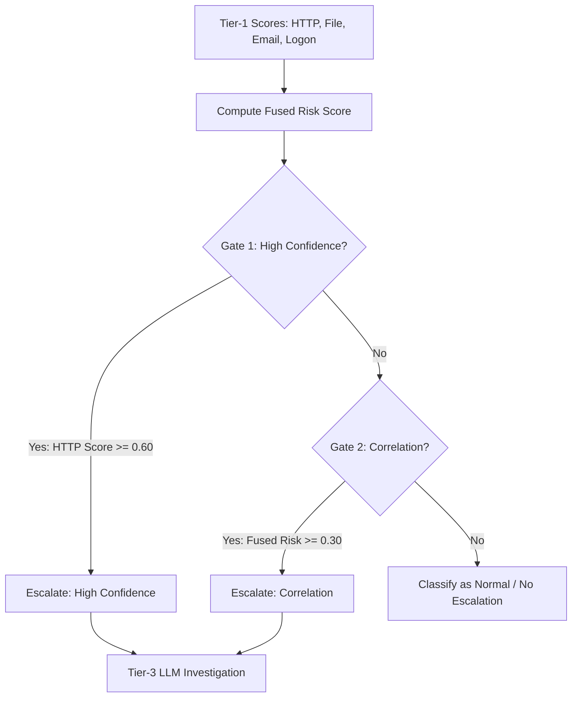

# Week 3: Tier-1 Scoring & Tier-2 Hierarchical Orchestration

**Project:** Hierarchical Multi-Agent Insider Threat Detection System  
**Dataset:** Carnegie Mellon SEI CERT Insider Threat Dataset v4.2  
**Status:** Authoritative Milestone Report

---

## 1. Executive Summary

Week 3 established the hierarchical fusion layer (Tier 2) that combines independent behavioral anomaly signals from the four Tier-1 MLP agents:
1. **Inference-Only Tier-1 Score Generation (`tier1_score_generation.ipynb`):** Executed inference across Validation (61,076 rows) and held-out Test (61,203 rows) splits using pretrained MLP weights and train-fitted standard scalers, exporting `tier1_validation_scores.csv` and `tier1_test_scores.csv`.
2. **Weighted Fusion Baseline (`tier2_fusion_agent1.ipynb`):** Implemented a vectorized weighted-sum baseline. Evaluated fixed domain weights ($40/40/10/10$) and validation-optimized weights ($50/20/15/15$).
3. **LangGraph Sequential Orchestrator (`tier2_langgraph_orchestrator.ipynb`):** Designed an explicit multi-agent StateGraph orchestrator featuring a two-stage sequential gating mechanism:
   - **Gate 1 (High-Confidence Gate):** Escalates single-modality extreme anomalies.
   - **Gate 2 (Correlation Gate):** Escalates multi-modality coordinated anomalies where individual scores are moderate but their fused risk exceeds the correlation threshold.
4. **Validation Tuning Protocol:** Calibrated operating thresholds strictly on Validation data via Youden's J grid sweep, freezing parameters before touching the held-out Test split.

---

## 2. Tier-1 Score Generation Architecture

The Tier-1 scoring pipeline operates in **inference-only mode** to guarantee reproducibility:
- **Models Loaded:** HTTP MLP (6:1), File/Device MLP (4:1), Email MLP (4:1), Logon MLP (4:1) (`ModalityFFNN` state dicts).
- **Preprocessing:** `StandardScaler` instances fitted exclusively on the 600 Train users (185,744 records), persisted alongside models to prevent data leakage.
- **Score Outputs:** Generates daily probability scores $s_{\text{http}}, s_{\text{file}}, s_{\text{email}}, s_{\text{logon}} \in [0, 1]$ aligned with user metadata `(user, week, day, label)`.

---

## 3. Tier-2 Architectural Designs

### 3.1 Gating Mechanism & Decision Rules
1. **Fused Risk Computation:**
   $$\text{Risk} = w_{\text{http}} s_{\text{http}} + w_{\text{file}} s_{\text{file}} + w_{\text{logon}} s_{\text{logon}} + w_{\text{email}} s_{\text{email}}$$
   $$\text{Final Frozen Weights: } w_{\text{http}}=0.50,\; w_{\text{file}}=0.20,\; w_{\text{logon}}=0.15,\; w_{\text{email}}=0.15$$
2. **Gate 1 (High-Confidence Gate):**
   $$\text{Triggered if } s_{\text{http}} \ge \tau_{\text{HC}} \quad (\tau_{\text{HC}} = 0.60)$$
3. **Gate 2 (Correlation Gate):**
   $$\text{Triggered if } \text{Risk} \ge \tau_{\text{corr}} \quad (\tau_{\text{corr}} = 0.30)$$

### 3.2 Threshold Optimization on Validation Set (`improved_tier2_optimization.ipynb`)
To prevent test set leakage, all hyperparameters were tuned strictly on the 200 Validation users (61,076 records, 201 positive days):
- Grid search over $\tau_{\text{HC}} \in [0.50, 0.95]$ and $\tau_{\text{corr}} \in [0.20, 0.60]$.
- Selected operating point ($\tau_{\text{HC}} = 0.60, \tau_{\text{corr}} = 0.30$) maximized Validation F1-score ($0.4666$) while maintaining false positive rates below $1\%$.

---

## 4. Evaluation Results on Held-Out Test Split (200 Users, 61,203 Rows)

The tuned parameters were frozen and evaluated exactly once on the held-out Test set:

| System / Model | Recall (TPR) | Precision | F1 Score | FPR | ROC-AUC | Escalations |
|---|:---:|:---:|:---:|:---:|:---:|:---:|
| **Week 1 Flat Random Forest** | 0.6418 | 0.2074 | 0.3135 | 0.0081 | 0.9416 | 622 |
| **Tier-2 Weighted Fusion Baseline** | 0.8857 | 0.2311 | 0.3648 | 0.0095 | 0.9802 | 753 |
| **Tier-2 LangGraph Orchestrator (Final)** | **0.8856** | **0.2500** | **0.3899** | **0.0088** | **0.9829** | **712** |

### 4.1 Confusion Matrix Analysis (Final LangGraph on Test Set)
- **Total Test User-Days:** 61,203
- **True Positives (TP):** 178 (out of 201 actual malicious days)
- **False Positives (FP):** 534 (out of 61,002 normal days)
- **False Negatives (FN):** 23
- **True Negatives (TN):** 60,468
- **Total Escalated Cases:** **712** (1.16% of total enterprise activity)
  - Escalated via High-Confidence Gate: 489 cases
  - Escalated via Correlation Gate: 223 cases

---

## 5. Comparison & Key Conclusions

1. **Substantial Recall Gain Over Week 1:** The Hierarchical Orchestrator improved malicious day detection from 64.18% (Random Forest) to **88.56%** (+24.38% absolute recall increase).
2. **Effective Enterprise Workload Filtering:** By reducing 61,203 user-days down to exactly 712 escalated cases, Tier 2 filtered out **98.84%** of benign enterprise noise, making Tier-3 deep LLM investigation computationally viable.
3. **Equivalence & Latency:** Vectorized execution achieved over 150,000 rows/sec throughput, while the single-case LangGraph state execution maintained a latency of ~1.13 ms per transaction.

---

## 6. Artifact & Notebook Inventory

- `week3/tier1_score_generation.ipynb` — Inference-only generation of validation and test score matrices (`tier1_validation_scores.csv`, `tier1_test_scores.csv`).
- `week3/tier2_fusion_agent1.ipynb` — Canonical weighted-fusion baseline implementation.
- `week3/tier2_langgraph_orchestrator.ipynb` — Canonical LangGraph orchestrator implementation and gating logic.
- `week3/improved_tier2_optimization.ipynb` — Validation grid sweep selecting frozen weights and thresholds.
- `week3/tier2_fusion_weight_selection.ipynb` — Weight sensitivity analysis across 5 candidate strategies.
- `week3/tier1_lib.py` — Single-source-of-truth library defining Tier-1 models, scalers, and inference helpers.
- `week3/final_week3_report.md` — Authoritative Milestone 3 Report.
