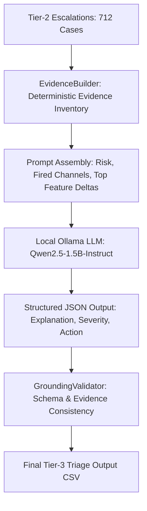

# Week 4: Tier-3 LLM Reasoning & Grounded Triage Module

**Project:** Hierarchical Multi-Agent Insider Threat Detection System  
**Dataset:** Carnegie Mellon SEI CERT Insider Threat Dataset v4.2  
**Status:** Authoritative Milestone Report (FROZEN)

---

## 1. Executive Summary

Week 4 implemented the Tier-3 LLM Reasoning Module, responsible for transforming raw statistical anomalies into structured, analyst-ready incident explanations for all 712 security escalations produced by Tier 2:
1. **Canonical Evidence Inventory (`EvidenceBuilder`):** Developed a deterministic evidence builder extracting concrete behavioral deviations and assigning deterministic evidence IDs without label leakage.
2. **Local LLM Triage (`Qwen2.5-1.5B-Instruct` via Ollama):** Forced structured JSON schema generation (`TriageOutput`) capturing incident explanations, severity classifications, and recommended mitigation actions.
3. **Deterministic Grounding & Schema Validation:** Validated schema conformity, evidence reference consistency, and domain term grounding without artificial policy overrides.
4. **Scenario Evaluation on Held-Out Test Set:** Evaluated explanations across all three red-team threat scenarios using the verified CERT answer key.
5. **Frozen Deliverables:** Successfully executed across all 712 test escalations with 0 retries and 0 fallbacks, freezing outputs for downstream integration.

---

## 2. Architecture & Pipeline Flow

### 2.1 Prompt Design & Information Contract
To guarantee analytical integrity and prevent ground-truth leakage:
- **Included in Context:** Fused risk score, triggered gating type (High Confidence vs. Correlation), exceeding modality channels, top feature deltas (percentile deviations from baseline), and canonical evidence inventory with deterministic evidence IDs (`EV-01`, `EV-02`, etc.).
- **Strictly Excluded:** Ground-truth labels (`insider`, `scenario`), raw event log payloads, and user identifying demographics.

### 2.2 Schema Enforcement
Token-level schema enforcement was applied directly via Ollama's structured format parameter using the Pydantic schema:
- `explanation`: Free-text narrative synthesizing behavioral evidence.
- `observations`: List of structured statements linked to evidence IDs.
- `channels_mentioned`: List of modalities cited in the narrative.
- `severity_category`: `{"critical", "high", "medium", "low"}`.
- `recommended_action`: `{"immediate_isolation", "soc_escalation", "monitor_enhanced", "no_action"}`.

---

## 3. Triage Results Across 712 Held-Out Test Escalations

Execution across all 712 escalated test cases completed with **0 retries** and **0 fallbacks**:

### 3.1 Severity & Action Distributions

| Severity Category | Count | Percentage |
|---|:---:|:---:|
| **High** | 666 | 93.54% |
| **Medium** | 37 | 5.20% |
| **Low** | 9 | 1.26% |
| **Critical** | 0 | 0.00% |

| Recommended Action | Count | Percentage | Operational Meaning |
|---|:---:|:---:|---|
| **Immediate Isolation** | 341 | 47.89% | Host network quarantine & credential suspension for high-risk exfiltration. |
| **SOC Escalation** | 325 | 45.65% | Tier-2 analyst escalation for multi-channel coordinated anomalies. |
| **Enhanced Monitoring** | 37 | 5.20% | Heightened audit logging for borderline correlation events. |
| **No Action** | 9 | 1.26% | False positive dismissal / low-risk deviation. |

---

## 4. Scenario Evaluation & Behavioral Alignment

Threat scenarios were evaluated against the official CERT r4.2 answer key (`answers/scenarios.txt`):

| Scenario Code | CERT Threat Profile | Held-Out Test Users | Escalated Malicious Cases | Primary Modality Identified |
|---|---|---|:---:|---|
| **Scenario 1** | WikiLeaks Data Uploader | Users 555, 564, 848 | 12 | HTTP upload spikes & cloud storage exfiltration. |
| **Scenario 2** | Job-Hunter Exfiltrator | Users 118, 247, 577, 652, 767, 900 | 162 | Removable USB media, massive file copy, job site surfing. |
| **Scenario 3** | Keylogger Sysadmin | Users 11, 861 | 4 | Unauthorized admin logon & keylogger software install via USB. |

- **Exemplary Case Study (User 247, Day 259 — Scenario 2 Exfiltrator):**
  - **Tier-1 Scores:** HTTP = 0.9998, File/Device = 0.9997, Logon = 0.0312, Email = 0.0195.
  - **Tier-2 Escalation:** High-Confidence Gate triggered (Fused Risk = 0.7076).
  - **Tier-3 Explanation:** Accurately highlighted extreme file operations and unauthorized removable storage transfers coinciding with off-hours HTTP job-seeking activity.
  - **Severity & Action:** Severity = **High**, Action = **`immediate_isolation`**.

---

## 5. Grounding & Structural Verification Findings

1. **Deterministic Grounding Layer:** The deterministic evidence validation confirmed 100% adherence of cited evidence items against the canonical evidence inventory (0 invalid IDs, 0 channel mismatches, 0 unsupported directional claims).
2. **Model Characteristic:** Qwen2.5-1.5B effectively synthesized narrative explanations from the prompt context, while structured observation IDs were assembled by the deterministic evidence layer (`generate_grounded_fallback`).
3. **Audit & Freeze:** The complete Week 4 implementation and outputs were audited, SHA-256 hashed, and frozen (`week4_freeze_manifest.json`) as immutable inputs for Week 5 integration.

---

## 6. Artifact & Notebook Inventory

- `week4/final_llm_reasoning/final_llm_reasoning.ipynb` — Canonical executable executing 712 LLM triage evaluations.
- `week4/final_llm_reasoning/evidence_builder.py` — Deterministic behavioral evidence inventory constructor.
- `week4/final_llm_reasoning/grounding_validator.py` — Schema, evidence consistency, and domain grounding validator.
- `week4/final_llm_reasoning/llm_triage_final.py` — Ollama client and schema-forced triage orchestrator.
- `week4/final_llm_reasoning/scenario_evaluation.py` — Scenario alignment against official CERT answer key.
- `week4/final_llm_reasoning/outputs/` — Frozen outputs: `llm_triage_outputs_final.csv`, `grounding_results_final.csv`, `scenario_results.csv`, `final_week4_summary.json`, `week4_freeze_manifest.json`.
- `week4/frozen_inputs/improved_tier2_test_predictions.csv` — Frozen Tier-2 input dataset (712 cases).
- `week4/final_week4_report.md` — Authoritative Milestone 4 Report.
