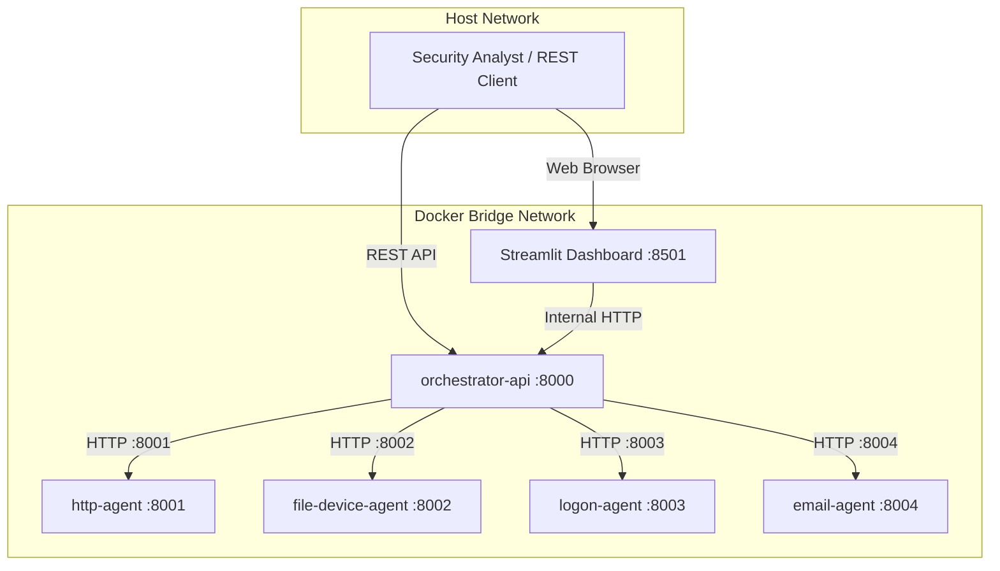

# Week 6: Production Deployment, Microservices Architecture & Analyst Dashboard

**Project:** Hierarchical Multi-Agent Insider Threat Detection System  
**Dataset:** Carnegie Mellon SEI CERT Insider Threat Dataset v4.2  
**Status:** Authoritative Milestone Report

---

## 1. Executive Summary

Week 6 delivered the complete deployment layer for the Hierarchical Multi-Agent Insider Threat Detection System:
1. **Multi-Service Microservice Deployment (`docker-compose.yml`):** Implemented a distributed container architecture isolating the four Tier-1 MLP agents (`http-agent`, `file-device-agent`, `logon-agent`, `email-agent`), a central Tier-2 orchestrator API (`orchestrator-api`), and an interactive analyst UI (`dashboard`).
2. **Read-Only Frozen Artifact Integrity (`artifact_integrity.py`):** Established an automated cryptographic SHA-256 verification module that validates all 22 frozen research models, scalers, and test outputs at service startup.
3. **Interactive Security Dashboard (`week6/dashboard/app.py`):** Developed a Streamlit security operations console featuring a 9-panel incident investigation view, scenario filtering, SHAP attribution breakdowns, and LLM triage reviews.
4. **End-to-End Equivalence & Test Suite:** Verified 100% mathematical equivalence between distributed microservice execution and the frozen research pipeline across 42 automated pytest suites.

---

## 2. System Deployment Architecture



### 2.1 Microservice Containers & Roles

| Service Container | Port | Component Role | Mounted Volumes (Read-Only) |
|---|:---:|---|---|
| `http-agent` | `8001` | Tier-1 HTTP Anomaly Agent (MLP 6:1) | `tier1/http/` (`model.pt`, `scaler.joblib`, `meta.json`) |
| `file-device-agent` | `8002` | Tier-1 File/Device Anomaly Agent (MLP 4:1) | `tier1/file_device/` (`model.pt`, `scaler.joblib`, `meta.json`) |
| `logon-agent` | `8003` | Tier-1 Logon Anomaly Agent (MLP 4:1) | `tier1/logon/` (`model.pt`, `scaler.joblib`, `meta.json`) |
| `email-agent` | `8004` | Tier-1 Email Anomaly Agent (MLP 4:1) | `tier1/email/` (`model.pt`, `scaler.joblib`, `meta.json`) |
| `orchestrator-api` | `8000` | Tier-2 LangGraph Gating, Escalations, `/case` | `week4/frozen_inputs/`, `week4/.../outputs/`, `week5/.../outputs/` |
| `dashboard` | `8501` | Streamlit Analyst Incident Viewer | Talks exclusively to `orchestrator-api` via HTTP |

---

## 3. Cryptographic Artifact Integrity Verification

To prevent configuration drift, silent regressions, or data tampering, `week6/artifact_integrity.py` computes and validates SHA-256 digests at container startup:
- **Scope:** 22 total checks (19 cryptographically hashed model weights, scalers, and test result matrices + 3 dataset presence checks).
- **Enforcement:** The service fails fast and refuses to boot if any hash mismatch occurs.
- **Verification Status:** **22 / 22 artifacts verified (PASS)**.

---

## 4. Security Operations Dashboard

The Streamlit dashboard (`week6/dashboard/app.py`) provides an interactive interface for SOC analysts:
1. **Case Selection & Incident Feed:** Browse and filter all 712 test-split security escalations by user, day, risk score, and threat scenario.
2. **Tier-1 Modality Gauge Panel:** Real-time visual comparison of daily anomaly scores against individual threshold baselines.
3. **Tier-2 Gating Diagnostics:** Clear visual indicators detailing whether escalation occurred via High-Confidence Gate ($\ge 0.60$) or Correlation Gate ($\ge 0.30$).
4. **SHAP Feature Attribution:** Visual breakdown of top contributing behavioral features explaining the model's prediction.
5. **Tier-3 LLM Triage Narrative:** Displays Qwen2.5-1.5B synthesized incident explanations, assigned severity category, and recommended mitigation actions (`immediate_isolation`, `soc_escalation`, `monitor_enhanced`).

---

## 5. Automated Verification & Test Results

The deployment was validated against a 42-test pytest suite:

| Test Group | Test Module | Tests | Result | Focus Area |
|---|---|:---:|:---:|---|
| **Pipeline Core** | `test_pipeline.py` | 12 | **PASS** | Model loading, feature alignment, gating contracts, degradation. |
| **Case Service & API** | `test_week6_case.py` | 13 | **PASS** | `/case`, `/cases`, 712-case reproduction, artifact fail-fast. |
| **Explanation Layer** | `test_week6_explain.py` | 10 | **PASS** | SHAP feature lookups, LLM explanation retrieval, evidence integrity. |
| **Microservices & Equivalence** | `test_week6_microservices.py` | 7 | **PASS** | Microservice agent routing, health checks, exact mathematical equivalence. |
| **Total Test Suite** | — | **42** | **100% PASS** | Zero regressions across all operational endpoints. |

---

## 6. How to Run Deployment

### 6.1 Multi-Container Docker Compose
```powershell
# Build and launch all microservices + dashboard
docker compose up --build

# Access services:
# - Streamlit Dashboard: http://localhost:8501
# - Orchestrator API Docs: http://localhost:8000/docs
```

### 6.2 Local Execution
```powershell
# Verify artifact integrity
python -m week6.artifact_integrity

# Start Orchestrator API
uvicorn week6.orchestrator:app --port 8000

# Start Streamlit Dashboard
streamlit run week6/dashboard/app.py
```

---

## 7. Artifact & Code Inventory

- `docker-compose.yml` — Multi-container microservice orchestration specification.
- `Dockerfile` — Base container specification.
- `week6/orchestrator.py` — Central Tier-2 Orchestrator API microservice.
- `week6/tier1_agent.py` — Generic Tier-1 Modality Agent microservice wrapper.
- `week6/case_service.py` — High-performance read-only case indexing and retrieval service.
- `week6/explain.py` — Unified SHAP and LLM explanation synthesis provider.
- `week6/artifact_integrity.py` — Cryptographic SHA-256 artifact verification module.
- `week6/dashboard/app.py` — Streamlit 9-panel security operations dashboard.
- `week6/entrypoint.sh` — Container initialization script with integrity gating.
- `week6/final_week6_report.md` — Authoritative Milestone 6 Report.
